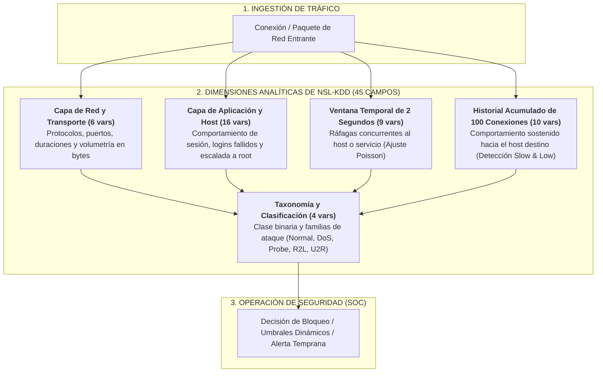
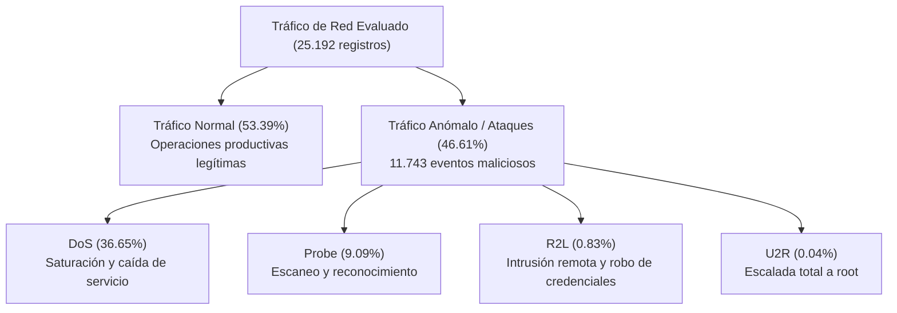

# Documentación y Especificación Técnica: Dataset NSL-KDD (20% Curado)

> **Archivo asociado:** [`nsl_kdd_20percent_curado.csv`](file:///c:/Users/darko/OneDrive/Documentos/Github/DatasetCiberseguridad/nsl_kdd_20percent_curado.csv)  
> **Fecha de generación:** 15 de Octubre de 2026  
> **Volumen de registros:** 25.192 conexiones de red  
> **Total de atributos:** 45 columnas (43 originales + 2 enriquecidas)  
> **Valores nulos o vacíos:** 0 (100% curado)  
> **Registros duplicados:** 0  

---

## 1. Introducción y Contexto del Dataset

El conjunto de datos **NSL-KDD** es el estándar de referencia en la investigación de sistemas de detección de intrusiones en redes (NIDS). Fue desarrollado por la Universidad de New Brunswick (UNB) para resolver los sesgos estructurales del histórico benchmark KDD'99 (eliminando millones de registros redundantes que inflaban artificialmente la precisión de los modelos y garantizando una proporción representativa de ataques complejos).

Para este proyecto se utiliza el subconjunto de entrenamiento **`KDDTrain+_20Percent.txt`**, el cual concentra el 20% del corpus de entrenamiento original manteniendo intacta la distribución de ataques, ideal para entornos de laboratorio, análisis estadístico exploratorio (EDA) y optimización computacional.

---

## 2. Estructura Interna del Dataset: Dimensiones y Arquitectura de Datos

En lugar de ver los 45 atributos como una lista plana, el dataset se estructura en **5 dimensiones analíticas** que capturan desde el paquete elemental hasta el comportamiento histórico y la severidad:



### Tabla Maestra de Dimensiones del Dataset

| Dimensión / Módulo | Variables Clave | Cantidad | Fenómeno de Red que Mide | Aplicación y Valor para la Empresa |
|:---|:---|:---:|:---|:---|
| **1. Conexión Básica (Red y Transporte)** | `duration`, `protocol_type`, `service`, `flag`, `src_bytes`, `dst_bytes` | 6 | Parámetros esenciales de conexión TCP/UDP/ICMP, puertos de destino y bytes transferidos. | Detección de fugas de datos (asimetría en bytes), servicios no autorizados y fallos de handshake TCP. |
| **2. Contenido de Host (Aplicación)** | `num_failed_logins`, `logged_in`, `root_shell`, `su_attempted`, `num_compromised`, `hot`, `land`, `num_file_creations`... | 16 | Actividad interna dentro de la sesión tras conectarse a un servicio o terminal. | **Detección de fuerza bruta en logins** y alertas críticas de **escalada de privilegios a superusuario root**. |
| **3. Ventana Temporal (2 Segundos)** | `count`, `srv_count`, `serror_rate`, `srv_serror_rate`, `rerror_rate`, `same_srv_rate`, `diff_srv_rate`... | 9 | Tasa de solicitudes concurrentes hacia el mismo host o servicio en los últimos 2 seg. | **Modelado probabilístico con Poisson**: Identificación instantánea de ráfagas masivas de denegación de servicio (DoS) y escaneos rápidos. |
| **4. Histórico de Host (100 Conexiones)** | `dst_host_count`, `dst_host_srv_count`, `dst_host_same_srv_rate`, `dst_host_diff_srv_rate`, `dst_host_serror_rate`... | 10 | Concurrencia y estado acumulado en las últimas 100 conexiones hacia el mismo destino. | Detección de **ataques lentos (*slow & low*)** diseñados intencionalmente para evadir la ventana corta de 2 segundos. |
| **5. Clasificación y Severidad** | `attack_type`, `attack_category`, `class_binary`, `difficulty_level` | 4 | Etiquetado granular del ataque, categoría corporativa MIT Lincoln Lab y nivel de dificultad ML. | Priorización de incidentes en el SOC y evaluación de modelos de Machine Learning. |

---

## 3. Taxonomía de Ciberamenazas y Clasificación de Tráfico

El dataset categoriza el tráfico en **4 grandes familias de ataques corporativos** más el tráfico legítimo:



### Tabla Resumen de Amenazas e Impacto en el Negocio

| Categoría | Casos en el Dataset | % del Total | Ejemplos Principales | Impacto en el Negocio |
|:---|---:|---:|:---|:---|
| **Normal** | 13.449 | 53.39% | Tráfico web corporativo, correos, consultas DNS legítimas. | Operaciones productivas del día a día sin incidencias. |
| **DoS** *(Denial of Service)* | 9.234 | 36.65% | `neptune` (8.282), `smurf` (529), `back` (196), `teardrop` (188), `pod`, `land`. | **Indisponibilidad del servicio**: Caída de pasarelas de pago, caída de portales web e incumplimiento de Acuerdos de Nivel de Servicio (SLA) con clientes. |
| **Probe** *(Reconocimiento)* | 2.289 | 9.09% | `ipsweep` (710), `satan` (691), `portsweep` (587), `nmap` (301). | **Espionaje perimetral**: Un atacante externo mapea direcciones IP activas y puertos vulnerables antes de lanzar un ataque letal. |
| **R2L** *(Remote to Local)* | 209 | 0.83% | `warezclient` (181), `guess_passwd`, `imap`, `ftp_write`, `phf`, `multihop`. | **Intrusión no autorizada**: Robo de contraseñas de usuarios legítimos y acceso inicial a la red interna desde el exterior. |
| **U2R** *(User to Root)* | 11 | 0.04% | `buffer_overflow`, `rootkit`, `loadmodule`, `perl`. | **Máxima severidad**: Secuestro total del servidor por un atacante local que escala privilegios a superusuario `root`. |

---

## 4. Diccionario Exhaustivo de Atributos

### 4.1. Características Intrínsecas de la Conexión (Capa de Red y Transporte)

| # | Atributo | Tipo | Descripción y Rango | Utilidad y Relevancia Corporativa |
|:---:|:---|:---:|:---|:---|
| **1** | `duration` | `int64` | Segundos que dura la conexión [0 - 42862]. | Conexiones con duración 0 indican ráfagas DoS o escaneos rápidos; duraciones prolongadas señalan transferencias grandes o sesiones interactivas. |
| **2** | `protocol_type` | `object` | Protocolo de transporte: `tcp`, `udp`, `icmp`. | Esencial para estratificación. Ataques de inundación SYN se concentran en TCP, mientras que Smurf y sweeps emplean ICMP/UDP. |
| **3** | `service` | `object` | Servicio de destino en la red (66 valores: `http`, `ftp`, `smtp`, `private`, `domain_u`, etc.). | Identifica qué servidores y puertos están bajo asedio para auditoría y cierre de puertos. |
| **4** | `flag` | `object` | Estado de la conexión según banderas TCP (`SF`, `S0`, `REJ`, `RSTO`, etc.). | `SF` representa éxito normal; `S0` indica intento sin respuesta (SYN flood); `REJ` marca conexiones bloqueadas por firewall. |
| **5** | `src_bytes` | `int64` | Bytes enviados desde el cliente al host destino. | Detección de exfiltración de información o ataques con payloads voluminosos. |
| **6** | `dst_bytes` | `int64` | Bytes enviados desde el host destino hacia el cliente. | Descarga no autorizada de datos o respuestas anómalas de servidores internos. |

### 4.2. Características de Contenido y Comportamiento de Host (Capa de Aplicación)

| # | Atributo | Tipo | Descripción | Utilidad y Relevancia Corporativa |
|:---:|:---|:---:|:---|:---|
| **7** | `land` | `int64` | `1` si IP y puerto origen y destino coinciden; `0` si no. | Ataque de tipo *Land* diseñado para colapsar pilas TCP/IP antiguas. |
| **8** | `wrong_fragment` | `int64` | Cantidad de fragmentos TCP erróneos o superpuestos. | Detección de ataques de fragmentación (*Teardrop*) que intentan eludir firewalls. |
| **9** | `urgent` | `int64` | Número de paquetes con bandera de urgencia TCP activa. | Comportamientos anómalos en protocolos de control. |
| **10** | `hot` | `int64` | Indicador de acceso a carpetas del sistema o ejecución de binarios. | Detección de actividad maliciosa post-acceso. |
| **11** | `num_failed_logins` | `int64` | Cantidad de intentos fallidos de autenticación. | **Detección inmediata de ataques de fuerza bruta** o *password spraying*. |
| **12** | `logged_in` | `int64` | `1` si el inicio de sesión fue exitoso; `0` en caso contrario. | Correlación con intentos fallidos para verificar si una brecha tuvo éxito. |
| **13** | `num_compromised` | `int64` | Conteo de estados comprometidos en el host. | Indicador de compromiso y daño en archivos o procesos internos. |
| **14** | `root_shell` | `int64` | `1` si se abrió una consola con privilegios de administrador `root`. | **Alerta crítica de severidad máxima** (compromiso de superusuario). |
| **15** | `su_attempted` | `int64` | `1` si se ejecutó el comando `su root`. | Detección de intento de escalada de privilegios interna. |
| **16** | `num_root` | `int64` | Accesos realizados como superusuario. | Auditoría de acciones ejecutadas bajo privilegios elevados. |
| **17** | `num_file_creations` | `int64` | Archivos creados durante la sesión. | Creación de scripts, backdoors o malware descargado. |
| **18** | `num_shells` | `int64` | Número de consolas interactivas iniciadas. | Presencia de reverse shells o accesos de terminal remotos. |
| **19** | `num_access_files` | `int64` | Operaciones sobre archivos de control de acceso. | Intentos de modificar permisos de usuarios o contraseñas. |
| **20** | `num_outbound_cmds` | `int64` | Comandos salientes en sesiones FTP. | Movimiento lateral hacia otros servidores. |
| **21** | `is_host_login` | `int64` | `1` si el login proviene de la máquina host local. | Control de accesos locales vs remotos. |
| **22** | `is_guest_login` | `int64` | `1` si se inició sesión como cuenta de invitado (*guest*). | Abuso de cuentas de cortesía sin privilegios. |

### 4.3. Características de Tráfico en Ventana Temporal (Últimos 2 Segundos) — *Núcleo para Poisson*

| # | Atributo | Tipo | Descripción | Utilidad y Relevancia Corporativa |
|:---:|:---|:---:|:---|:---|
| **23** | `count` | `int64` | **Conexiones al mismo host destino en los últimos 2 seg.** [1 - 511]. | **Variable clave para el modelado de Poisson**. En tráfico normal la tasa es baja ($\lambda \approx 1-10$). En ráfagas DoS supera los cientos de conexiones. |
| **24** | `srv_count` | `int64` | Conexiones dirigidas al mismo servicio en los últimos 2 seg. | Permite diferenciar ráfagas a un solo puerto vs escaneos horizontales. |
| **25** | `serror_rate` | `float64` | % de conexiones en la ventana que terminaron con error SYN. | Señal inequívoca de ataques de inundación SYN Flood (`neptune`). |
| **26** | `srv_serror_rate` | `float64` | % de errores SYN al mismo servicio. | Confirmación de ataque dirigido a un daemon específico (ej. servidor web). |
| **27** | `rerror_rate` | `float64` | % de conexiones rechazadas (`REJ`) por el host. | Indica intentos de conexión contra puertos deliberadamente cerrados. |
| **28** | `srv_rerror_rate` | `float64` | % de conexiones rechazadas al mismo servicio. | Rechazo sistemático de conexiones. |
| **29** | `same_srv_rate` | `float64` | % de conexiones que usaron el mismo servicio en la ventana. | Valores cercanos a 1.0 son típicos de inundaciones DoS monomórficas. |
| **30** | `diff_srv_rate` | `float64` | % de conexiones a servicios distintos en la ventana. | **Detección de escaneo de puertos** (*Port Scanning*). |
| **31** | `srv_diff_host_rate` | `float64` | % de conexiones a distintos hosts para el mismo servicio. | Detección de ataques distribuidos salientes. |

### 4.4. Características Históricas de Tráfico del Host Destino (Últimas 100 Conexiones)

| # | Atributo | Tipo | Descripción | Utilidad y Relevancia Corporativa |
|:---:|:---|:---:|:---|:---|
| **32** | `dst_host_count` | `int64` | Conexiones acumuladas hacia el host destino [0 - 255]. | Monitoreo del estado acumulado de concurrencia del servidor. |
| **33** | `dst_host_srv_count` | `int64` | Conexiones acumuladas al mismo servicio en el destino. | Indicador de servidores con saturación sostenida de conexiones. |
| **34** | `dst_host_same_srv_rate` | `float64` | Proporción de conexiones históricas al mismo servicio. | Evaluación de consistencia en el tráfico entrante. |
| **35** | `dst_host_diff_srv_rate` | `float64` | Proporción de conexiones a diferentes servicios. | Identificación de escaneos lentos que operan fuera de la ventana de 2s. |
| **36** | `dst_host_same_src_port_rate` | `float64` | % de conexiones que comparten el mismo puerto de origen. | Típico de herramientas automáticas de ataque que no aleatorizan puertos. |
| **37** | `dst_host_srv_diff_host_rate` | `float64` | Proporción hacia diferentes hosts para el mismo servicio. | Mapeo de comportamiento distribuido. |
| **38** | `dst_host_serror_rate` | `float64` | % histórico de errores SYN recibidos por el host. | Diagnóstico de host bajo asedio prolongado. |
| **39** | `dst_host_srv_serror_rate` | `float64` | % histórico de errores SYN en un servicio determinado. | Detección de agotamiento de tabla de estados del servidor web/base de datos. |
| **40** | `dst_host_rerror_rate` | `float64` | % histórico de conexiones rechazadas por el host. | Monitoreo de actividad anómala contra el firewall local del host. |
| **41** | `dst_host_srv_rerror_rate` | `float64` | % histórico de conexiones rechazadas en un servicio. | Frecuencia de denegación en servicios expuestos. |

### 4.5. Variables Enriquecidas de Clasificación y Evaluación

| # | Atributo | Tipo | Valores Posibles | Utilidad y Relevancia Corporativa |
|:---:|:---|:---:|:---|:---|
| **42** | `attack_type` | `object` | 22 tipos (`normal`, `neptune`, `ipsweep`, etc.). | Clasificación multiclase granular para análisis forense. |
| **43** | `difficulty_level` | `int64` | Puntaje entero [0 - 21]. | Representa la dificultad histórica de detección por modelos de machine learning. |
| **44** | `attack_category` | `object` | `Normal`, `DoS`, `Probe`, `R2L`, `U2R`. | **Categorización ejecutiva corporativa** para informes gerenciales de riesgo. |
| **45** | `class_binary` | `object` | `normal`, `anomaly`. | Detección binaria inmediata para activar reglas de bloqueo en firewalls. |

---

## 5. Distribución Estadística en el Subconjunto del 20%

A partir de los 25.192 registros procesados, las proporciones reales son:

### 5.1. Distribución por Categoría de Tráfico

```
Normal (53.39%) ════════════════════════════════════════ [13.449 registros]
DoS    (36.65%) ═════════════════════════════ [9.234 registros]
Probe   (9.09%) ═══════ [2.289 registros]
R2L     (0.83%) █ [209 registros]
U2R     (0.04%) ▏ [11 registros]
```

### 5.2. Top 10 Vectores de Ataque Específicos

1. **`normal`**: 13.449 conexiones (tráfico legítimo)
2. **`neptune`**: 8.282 conexiones (SYN Flood DoS masivo)
3. **`ipsweep`**: 710 conexiones (Escaneo de direcciones IP vivas)
4. **`satan`**: 691 conexiones (Escáner de vulnerabilidades de red)
5. **`portsweep`**: 587 conexiones (Escaneo secuencial de puertos TCP)
6. **`smurf`**: 529 conexiones (Inundación ICMP por amplificación)
7. **`nmap`**: 301 conexiones (Reconocimiento activo de servicios)
8. **`back`**: 196 conexiones (Ataque de saturación a servidor web Apache)
9. **`teardrop`**: 188 conexiones (Ataque de fragmentación IP)
10. **`warezclient`**: 181 conexiones (Descarga ilegal y acceso a través de FTP)

---

## 6. ¿De Qué le Sirve Toda Esta Información a una Empresa?

### A. Optimización de Costos en Monitoreo de Seguridad (SOC en la Nube)
Las herramientas de observabilidad y ciberseguridad modernas (como Splunk, Datadog o Microsoft Sentinel) cobran en función de los **gigabytes de logs ingeridos por día**. Ingerir el 100% del tráfico de red en redes que operan a 10 Gbps resulta económicamente prohibitivo:
- **Solución con Muestreo Estadístico:** Aplicando **Muestreo Estratificado**, la empresa puede capturar únicamente el **10% del tráfico** ahorrando un 90% en costos de ingestión, garantizando que el perfil de amenazas (proporción de DoS, Probes e intrusiones) se preserva con error estadístico mínimo frente a la población real.

### B. Detección Temprana de Ráfagas mediante Modelado de Poisson
En una red corporativa, las conexiones por segundo (`count`) deben responder a un proceso de eventos independientes que se aproxima a una **distribución de Poisson** de parámetro $\lambda = \bar{x}$:
- **Regla de Alerta Predictiva:** Si en un lapso de 2 segundos se observa una cantidad $k$ tal que la probabilidad teórica $P(X \ge k)$ es inferior al 0.001 (evento altamente improbable), el sistema clasifica la ráfaga como un inicio de ataque DoS (como `neptune`) y activa defensas perimetrales automáticamente antes de que se agote la memoria del servidor.

### C. Reducción de la Superficie de Ataque (*Hardening*)
Analizando la variable `service` cruzada con `attack_category`, la gerencia de infraestructura puede identificar que servicios genéricos o inseguros (como `private` con más de 8.000 ataques de denegación de servicio, o `ftp_data` con ataques `warezclient`) concentran la mayor hostilidad, justificando el cierre de puertos, el aislamiento en VLANs dedicadas y la exigencia de VPN con autenticación multifactor.
