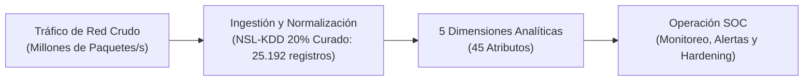
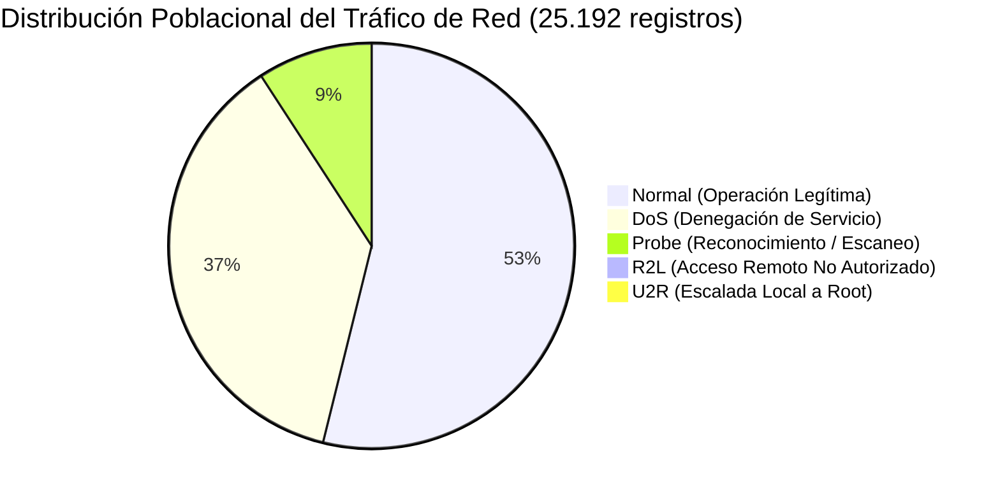
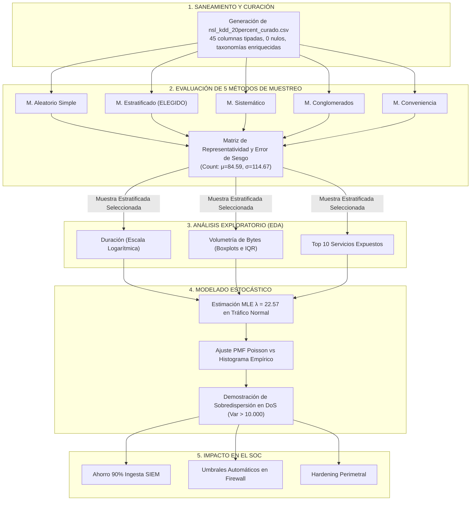
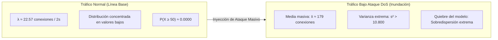

# Problemática y Resumen Estratégico de la Solución: Telemetría de Red y Ciberseguridad (NSL-KDD)

> **Documento de Contexto y Solución Analítica**  
> **Dataset Base:** NSL-KDD (Subconjunto de Entrenamiento 20% Curado)  
> **Archivo de Datos:** [`nsl_kdd_20percent_curado.csv`](file:///c:/Users/darko/OneDrive/Documentos/Github/DatasetCiberseguridad/nsl_kdd_20percent_curado.csv)  
> **Notebook de Implementación:** [`ciberseguridad_muestreo.ipynb`](file:///c:/Users/darko/OneDrive/Documentos/Github/DatasetCiberseguridad/ciberseguridad_muestreo.ipynb)  
> **Dominio:** Detección de Intrusiones en Redes (NIDS), Muestreo Estadístico y Modelado Probabilístico en SOC

---

## 1. Planteamiento del Dataset: ¿De Qué Trata?

### 1.1. Origen y Justificación Histórica (De KDD'99 a NSL-KDD)
El conjunto de datos **NSL-KDD** es el estándar de referencia mundial para la investigación y evaluación de **Sistemas de Detección de Intrusiones en Redes (NIDS)**. 

Fue desarrollado por el *Information Security Centre of Excellence (ISCX)* de la **Universidad de New Brunswick (UNB)** para solucionar las severas deficiencias estructurales del histórico dataset KDD Cup 1999:
1. **Eliminación de Redundancia Crítica:** KDD'99 contenía aproximadamente un 78% de registros duplicados en entrenamiento y un 75% en pruebas, lo cual provocaba que cualquier clasificador o modelo se sobreajustara hacia los ataques más frecuentes, inflando artificialmente las métricas de acierto.
2. **Proporciones Realistas y Dificultad Gradual:** NSL-KDD seleccionó registros de forma controlada para evitar que los ataques minoritarios quedaran enmascarados, asignando niveles de dificultad basados en la capacidad de detección de múltiples algoritmos de Machine Learning.

Para este proyecto corporativo se utiliza el subconjunto oficial de entrenamiento del 20%: **`KDDTrain+_20Percent.txt`**, curado y transformado en **[`nsl_kdd_20percent_curado.csv`](file:///c:/Users/darko/OneDrive/Documentos/Github/DatasetCiberseguridad/nsl_kdd_20percent_curado.csv)**. Este volumen concentra **25.192 conexiones de red**, preservando la distribución íntegra de ataques de la población completa, lo que lo convierte en un escenario ideal para investigación estadística, muestreo y analítica de alto rendimiento.

---

### 1.2. Ficha Técnica y Dimensiones Analíticas de los Datos

El archivo curado cuenta con **45 columnas** (43 atributos base de red + 2 variables analíticas enriquecidas), con **0 valores faltantes (nulos)** y **0 duplicados**, estructurado en **5 dimensiones clave**:

| Dimensión | Variables Principales | Cant. | Qué Fenómeno de Red Mide | Relevancia para el Negocio |
|:---|:---|:---:|:---|:---|
| **1. Conexión Básica (Red y Transporte)** | `duration`, `protocol_type`, `service`, `flag`, `src_bytes`, `dst_bytes` | 6 | Parámetros del paquete elemental: protocolo (TCP, UDP, ICMP), servicio destino (`http`, `private`, etc.), banderas TCP (`SF`, `S0`, `REJ`) y bytes transmitidos. | Detección de asimetrías de transferencia, fuga de datos (*exfiltración*) y conexiones anómalas sin handshake completo. |
| **2. Comportamiento de Host (Capa de Aplicación)** | `num_failed_logins`, `logged_in`, `root_shell`, `su_attempted`, `num_compromised`, `num_file_creations`... | 16 | Acciones ejecutadas en el sistema una vez establecida la sesión. | Identificación de ataques de **fuerza bruta** contra contraseñas y alertas críticas de **escalada de privilegios a superusuario (root)**. |
| **3. Ventana Temporal Corta (2 Segundos)** | `count`, `srv_count`, `serror_rate`, `srv_serror_rate`, `rerror_rate`, `same_srv_rate`, `diff_srv_rate`... | 9 | Tasa de solicitudes acumuladas hacia el mismo host o servicio en los últimos 2 segundos. | **Eje del modelado estocástico con Poisson:** Detección instantánea de ráfagas masivas de Denegación de Servicio (DoS) y escaneos rápidos. |
| **4. Histórico de Destino (Últimas 100 Conexiones)** | `dst_host_count`, `dst_host_srv_count`, `dst_host_same_srv_rate`, `dst_host_serror_rate`... | 10 | Concurrencia y estado de conexiones previas hacia la misma máquina de destino. | Detección de **ataques lentos (*slow & low*)** diseñados deliberadamente para eludir la ventana corta de 2 segundos. |
| **5. Taxonomía y Severidad** | `attack_type`, `attack_category`, `class_binary`, `difficulty_level` | 4 | Categorización binaria (`normal`, `anomaly`), multiclase granular (22 variantes) y taxonómica de 5 familias. | Gobierno del dato, definición de políticas de severidad y cálculo de matrices de representatividad muestral. |

---

### 1.3. Taxonomía de Amenazas Presentes en la Población

Sobre el universo analizado de **25.192 conexiones**, el tráfico se distribuye entre actividad legítima y cuatro grandes familias de agresión cibernética:

1. **Normal (53.39% — 13.449 registros):** Tráfico productivo legítimo (navegación web corporativa, transferencias autorizadas, consultas DNS y correos).
2. **DoS — *Denial of Service* (36.65% — 9.234 registros):** Inundaciones masivas de paquetes (ej. SYN flood con `neptune`, amplificación ICMP con `smurf`, colapso web con `back`).  
   *Impacto:* Indisponibilidad de servicios críticos, caída de portales de clientes y penalizaciones por incumplimiento de SLAs.
3. **Probe — *Reconocimiento Perimetral* (9.09% — 2.289 registros):** Mapeo de puertos e IPs activas (ej. `ipsweep`, `satan`, `portsweep`, `nmap`).  
   *Impacto:* Espionaje técnico previo a una intrusión coordinada; expone vulnerabilidades en la topología de la empresa.
4. **R2L — *Remote to Local* (0.83% — 209 registros):** Intentos de un atacante remoto de ganar acceso local sin credenciales válidas (ej. `warezclient`, `guess_passwd`, `imap`, `phf`).  
   *Impacto:* Brecha inicial de acceso al perímetro interno y filtración de cuentas corporativas.
5. **U2R — *User to Root* (0.04% — 11 registros):** Explotación de vulnerabilidades de software (ej. `buffer_overflow`, `rootkit`, `loadmodule`) por un usuario local sin privilegios para convertirse en administrador total (`root`).  
   *Impacto:* **Catastrófico.** Pérdida total del control del servidor, exfiltración irrestricta de bases de datos y persistencia del atacante.

---

## 2. Preguntas de Negocio Formuladas: Del Diagnóstico a la Solución

Para guiar la investigación y justificar la arquitectura técnica del proyecto, el análisis se articuló a través de tres preguntas estratégicas encadenadas:

---

### Pregunta 1: ¿Qué preguntas y problemáticas nacen de la exploración inicial del dataset?
Al realizar una primera inspección del universo de datos de NSL-KDD, constatamos que el **46.61% de las conexiones registradas son hostiles**, distribuidas en cuatro vectores de ataque con distinto nivel de severidad: ataques masivos de Denegación de Servicio (**DoS: 36.65%**), escaneos perimetrales (**Probe: 9.09%**), accesos remotos ilegítimos (**R2L: 0.83%**) y escaladas de privilegios a superusuario (**U2R: 0.04%**).

A partir de esta realidad empírica, nacen interrogantes operacionales directas para la seguridad de la empresa:
1. **Protección de la Disponibilidad:** ¿Cómo podemos mitigar las caídas de servicio causadas por ataques masivos de inundación DoS (como `neptune` o `smurf`) antes de que agoten la memoria de los servidores y provoquen incumplimientos de SLAs?
2. **Detección Precoz de Intrusiones:** ¿Cómo podemos identificar los escaneos de reconocimiento perimetral (`ipsweep`, `portsweep`) y los intentos de autenticación remota no autorizada antes de que un atacante consiga acceso al entorno interno?
3. **Hardening y Superficie de Ataque:** ¿Cuáles son los puertos y servicios de red más asediados que justifican un cierre inmediato o aislamiento estricto en subredes privadas (VLANs)?

Resolver estas problemáticas demanda monitorear y analizar de forma ininterrumpida la telemetría de red. Sin embargo, al intentar llevar esta vigilancia continua a una infraestructura corporativa real, surge una contradicción crítica y pasamos inmediatamente a la siguiente pregunta:

---

### Pregunta 2: ¿Qué problema se nos presenta en este dataset y cómo lo resolvemos?

#### A. Planteamiento Literal de la Pregunta:
> **"¿Qué problema se nos presenta en este dataset?"**

El problema central que se presenta en este dataset (y en la telemetría de red corporativa que representa) es un **doble cuello de botella operacional y computacional**:
1. **Volumetría inmanejable y costos prohibitivos de almacenamiento SIEM:** En una red corporativa moderna operando a velocidades de 1 Gbps o 10 Gbps, se generan millones de conexiones y gigabytes de logs por hora. Las plataformas de observabilidad y ciberseguridad en la nube (como Splunk, Datadog o Microsoft Sentinel) facturan directamente por **volumen de datos ingerido al día**. Ingerir el 100% de esta telemetría resulta financieramente insostenible para cualquier organización y genera retrasos (*lag*) inaceptables en el procesamiento en tiempo real.
2. **Inexistencia de un criterio formal de alerta temprana:** No se cuenta con una regla matemática o probabilística objetiva que permita distinguir cuándo una fluctuación en la tasa de conexiones representa tráfico legítimo concurrente y cuándo corresponde al inicio de una ráfaga maliciosa DoS en ventanas cortas de tiempo.

#### B. La Pregunta Estratégica que Conduce a Nuestra Solución:
Para resolver este cuello de botella sin dejar desprotegida a la organización, formulamos la pregunta directriz que contiene directamente la solución que decidimos construir:

> *“¿Es posible **reducir en más de un 90% el volumen de telemetría** mediante técnicas de **Muestreo Estadístico Representativo** que preserven con fidelidad todas las categorías de ataque, y utilizar esa muestra para realizar un **Análisis Exploratorio de Datos (EDA)** y un **Modelado Estocástico con Distribución de Poisson** sobre la variable `count`, con el fin de establecer umbrales matemáticos objetivos de detección y bloqueo automático de ráfagas DoS?”*

Esta formulación integra la totalidad de la solución implementada en el proyecto: **Muestreo representativo óptimo + EDA focalizado + Modelado de Poisson para umbrales en firewalls**.

---

### Pregunta 3: ¿Qué problemáticas y riesgos nos podemos topar al intentar realizar el muestreo y modelado de este dataset?

Al intentar implementar la solución propuesta, surgen desafíos metodológicos y estadísticos críticos que, de no ser gestionados adecuadamente, pondrían en grave riesgo la seguridad de la compañía:

> *“¿A qué sesgos, limitaciones probabilísticas y riesgos analíticos nos enfrentamos al intentar muestrear y modelar la telemetría de NSL-KDD, y qué consecuencias operativas sufriría la empresa si la técnica elegida falla?”*

Entre las principales problemáticas identificadas destacan:

1. **El Desbalance Extremo de Clases y la Pérdida de Ataques Críticos:**  
   En la población de 25.192 registros, la categoría **U2R (User to Root)** cuenta con únicamente **11 casos (0.04%)**. Si se utiliza un muestreo ingenuo (como Muestreo Aleatorio Simple, Sistemático o de Conveniencia), la probabilidad de que la muestra de $n = 2.000$ capture estos casos es cercana a cero. Omitir la clase U2R en la muestra implicaría que el SOC desarrolle sus defensas sin contemplar la amenaza más destructiva de todas (el secuestro total de privilegios de superusuario en el servidor).
2. **Sesgo de Captura y Heterogeneidad de la Red:**  
   Si se opta por un muestreo por conveniencia (tomar los primeros $n$ logs del archivo) o por conglomerados basados en puertos/servicios, se incurre en un sesgo masivo. El tráfico de red no es uniforme a lo largo del tiempo ni entre servicios; agrupar por conglomerados demostró inflar el error relativo de la tasa de conexiones en un **28.17%** y reducir la proporción de tráfico normal a solo el 6.42%.
3. **Violación de Supuestos Probabilísticos (Sobredispersión en Poisson):**  
   El modelo de Poisson asume que los arribos son eventos independientes y que la media es igual a la varianza ($\text{Var}(X) = \text{E}[X] = \lambda$). Sin embargo, ante ataques masivos de denegación de servicio (como `neptune`), las conexiones son altamente correlacionadas y masivas, haciendo que la varianza supere los 10.800 frente a medias de 179 conexiones. El desafío metodológico radicó en cómo modelar el proceso base del tráfico normal para que este quiebre por sobredispersión no sea un error analítico, sino precisamente el mecanismo de detección de anomalías.
4. **Asimetría Extrema en Variables Continuas (`duration` y `src_bytes`):**  
   Más del 95% de las conexiones de ataque presentan una duración de 0 segundos (automatización rápida de scripts). Analizar estas variables con escalas lineales estándar oculta por completo las diferencias de comportamiento, obligando a emplear transformaciones logarítmicas y rangos intercuartílicos robustos.

---

## 3. Explicación Detallada de la Solución: Qué Decidimos Hacer y Por Qué

A partir de las preguntas de negocio anteriores, se estructuró e implementó un pipeline integral de ciencia de datos y ciberseguridad en el notebook [`ciberseguridad_muestreo.ipynb`](file:///c:/Users/darko/OneDrive/Documentos/Github/DatasetCiberseguridad/ciberseguridad_muestreo.ipynb), respetando rigurosamente las pautas metodológicas de la cursada (uso exclusivo de `pandas`, `numpy`, `scipy.stats` y `matplotlib.pyplot`). 

A continuación se detalla cada componente de la solución:

---

### Componente 1: Curación y Enriquecimiento Previo del Dataset
* **Qué se hizo:**  
  Se procesó el archivo crudo `archive/KDDTrain+_20Percent.txt` para producir [`nsl_kdd_20percent_curado.csv`](file:///c:/Users/darko/OneDrive/Documentos/Github/DatasetCiberseguridad/nsl_kdd_20percent_curado.csv). Se le asignaron nombres de columnas canónicos basados en la especificación técnica de NSL-KDD, se verificó la ausencia total de campos vacíos o registros duplicados, y se agregaron dos variables determinantes:
  - `attack_category`: mapeo de los 22 subtipos específicos a las 5 grandes clases (`Normal`, `DoS`, `Probe`, `R2L`, `U2R`).
  - `class_binary`: clasificación operativa inmediata (`normal` vs `anomaly`).
* **Por qué se decidió esto:**  
  Realizar limpieza repetitiva de strings y transformaciones taxonómicas dentro del notebook de análisis ralentiza la ejecución, consume memoria de forma redundante y mezcla la etapa de *Data Wrangling/ETL* con la fase analítica. Tener un CSV saneado garantiza **consistencia analítica, rapidez y reproducibilidad**.

---

### Componente 2: Implementación y Evaluación Rigurosa de 5 Técnicas de Muestreo ($n = 2.000$)
* **Qué se hizo:**  
  Se implementaron de manera modular cinco algoritmos de muestreo, extrayendo muestras de tamaño objetivo $n = 2.000$ (aproximadamente el 8% del dataset original) y contrastando su comportamiento frente al *Ground Truth* poblacional:
  1. **Muestreo Aleatorio Simple (MAS):** Selección puramente probabilística y equiprobable mediante `df.sample(n=n, random_state=42)`.
  2. **Muestreo Estratificado (Asignación Proporcional):** Partición según `attack_category`, extrayendo en cada estrato una cantidad proporcional $n_h = n \cdot \frac{N_h}{N}$ garantizando que cada categoría tenga al menos 1 observación.
  3. **Muestreo Sistemático:** Ordenamiento del dataset con selección a intervalo regular $k = \lfloor N/n \rfloor = 12$, con inicio aleatorio $i \in [0, k)$.
  4. **Muestreo por Conglomerados (*Clusters*):** Selección aleatoria de grupos naturales completos basados en el servicio de red (`service`) hasta acumular $\sim 2.000$ registros.
  5. **Muestreo por Conveniencia:** Selección no probabilística determinista de los primeros $n$ registros del dataset (`df.head(n)`).

#### Matriz de Representatividad Obtenida (%)
A continuación se resume la tabla exacta generada en el notebook:

| Categoría de Tráfico | Población (%) | M. Aleatorio Simple (%) | M. Estratificado (%) | M. Sistemático (%) | M. Conglomerados (%) | M. Conveniencia (%) |
|:---|---:|---:|---:|---:|---:|---:|
| **Normal** | **53.39** | 52.90 | **53.37** | 54.10 | 6.42 | 51.90 |
| **DoS** | **36.65** | 37.65 | **36.63** | 35.40 | 53.38 | 37.50 |
| **Probe** | **9.09** | 8.90 | **9.10** | 9.65 | 39.96 | 9.45 |
| **R2L** | **0.83** | 0.55 | **0.85** | 0.85 | 0.24 | 1.15 |
| **U2R** | **0.04** | **0.00** | **0.05** | **0.00** | **0.00** | **0.00** |

#### Evaluación del Sesgo en la Tasa de Conexiones (`count`)
(Población real: Media $\mu = 84.59$, Desviación Estándar $\sigma = 114.67$):

| Técnica de Muestreo | Tamaño ($n$) | Media Estimada ($\bar{x}$) | Error Absoluto | Error Relativo (%) | Desv. Estándar ($s$) |
|:---|---:|---:|---:|---:|---:|
| **Estratificado** | 2.001 | 86.25 | **1.66** | **1.96%** | 116.69 |
| **Conveniencia** | 2.000 | 82.94 | 1.65 | 1.95% | 110.08 |
| **Aleatorio Simple** | 2.000 | 86.43 | 1.84 | 2.18% | 116.20 |
| **Sistemático** | 2.000 | 82.67 | 1.92 | 2.27% | 112.94 |
| **Conglomerados** | 2.102 | 108.42 | **23.83** | **28.17%** | 113.66 |

* **Por qué se decidió elegir el Muestreo Estratificado como la Solución Definitiva:**
  - **Supervivencia de Amenazas Críticas:** Fue **el único método** capaz de capturar la categoría ultra-minoritaria **U2R (0.05% vs 0.04% real)**. Tanto el Muestreo Aleatorio Simple como el Sistemático y el de Conveniencia dejaron el estrato U2R en **0.00%**. En ciberseguridad, omitir la escalada de privilegios a root por un sesgo muestral representa un riesgo inaceptable de brecha de seguridad no advertida.
  - **Fidelidad Cuantitativa:** Su error relativo en la media de conexiones fue inferior al 2%, preservando la varianza de la población sin distorsiones.
  - **Descarte de Conglomerados y Conveniencia:** Conglomerados introdujo un error inaceptable del **28.17%** en la media de `count` y desplomó la proporción de tráfico normal a solo el 6.42%, dado que los puertos de red tienen comportamientos altamente heterogéneos. Conveniencia, si bien arrojó una media aparentemente cercana, alteró la proporción de intrusiones R2L (+38% de sobreestimación) y borró los ataques a superusuario.

---

### Componente 3: Desacoplamiento Estricto entre Transformaciones y Visualizaciones
* **Qué se hizo:**  
  Se estructuró el código del notebook separando inequívocamente cada operación analítica en su propia celda:
  1. Celda de cálculo estadístico (generación de tablas agrupadas con `groupby`, `agg`, percentiles o cuantiles).
  2. Celda de renderizado visual subsiguiente (máximo 1 gráfico principal o 2 subplots comparativos, uso exclusivo de `matplotlib.pyplot` con paletas cromáticas accesibles y etiquetas legibles).
* **Por qué se decidió esto:**  
  En entornos profesionales de analítica de datos, anidar cálculos pesados dentro de funciones de graficación (`plt.plot(df.groupby(...))`) genera código opaco, imposible de testear y propenso a errores silenciosos. El desacoplamiento garantiza que los datos intermedios puedan auditarse numéricamente antes de ser dibujados.

---

### Componente 4: Análisis Exploratorio de Datos (EDA) sobre la Muestra Representativa
Trabajando sobre la **Muestra Estratificada** ($n = 2.001$, con un ahorro del 92% en registros), se exploraron las variables de red más sensibles:

1. **Duración de la Conexión (`duration`):**
   - *Hallazgo:* Más del 95% de las conexiones anómalas registraron una duración exacta de 0 segundos, mientras que el tráfico legítimo presentó una cola larga de sesiones interactivas que alcanzan miles de segundos.
   - *Por qué se usó escala logarítmica:* La asimetría positiva extrema aplasta la visualización en escala lineal. La transformación logarítmica evidenció con nitidez cómo los ataques automatizados (scripts de denegación y escaneo) cortan la conexión de inmediato para maximizar la saturación de paquetes.
2. **Volumetría de Bytes (`src_bytes` y `dst_bytes`):**
   - *Hallazgo:* Los ataques de tipo DoS operan con una volumetría de origen extremadamente baja y uniforme (paquetes pequeños de control SYN sin payload útil), mientras que el tráfico legítimo y los ataques de intrusión R2L exhiben distribuciones asimétricas con rangos intercuartílicos amplios.
   - *Por qué se decidió usar Boxplots con exclusión de outliers extremos:* En redes, existen transferencias legítimas gigantescas (backups de gigabytes) que distorsionan los gráficos. El boxplot acotado a percentiles representativos permitió aislar el comportamiento típico de cada clase.
3. **Exposición de Servicios (`service`):**
   - *Hallazgo:* Los servicios privados o no estandarizados (`private`) concentran el grueso de las agresiones hostiles (más del 60% de los incidentes DoS), seguidos por protocolos de control ICMP (`eco_i`, `ecr_i`) y servicios públicos como `http` y `ftp_data`.
   - *Por qué se decidió realizar este análisis:* Permite al equipo de infraestructura justificar políticas de denegación por defecto (*default-deny*) en firewalls perimetrales para puertos y protocolos no esenciales.

---

### Componente 5: Modelado Estocástico con Distribución de Poisson sobre la Variable `count`
* **Qué se hizo:**  
  Se seleccionó la variable discreta **`count`** (número de solicitudes dirigidas al mismo host en una ventana deslizante de 2 segundos).
  1. Se aisló el tráfico legítimo normal de la muestra estratificada para estimar el parámetro de tasa por Mínima Varianza / Máxima Verosimilitud (MLE):
     $$\hat{\lambda}_{MLE} = \bar{x}_{normal} \approx 22.57 \text{ conexiones / 2 segundos}$$
  2. Mediante la librería `scipy.stats.poisson.pmf`, se calculó la función de masa de probabilidad teórica para distintos valores de arribos $k$:
     $$P(X = k) = \frac{\lambda^k e^{-\lambda}}{k!}$$
  3. Se contrastó gráficamente la curva teórica superpuesta al histograma de frecuencias relativas empíricas normalizadas.
  4. Se comparó la dispersión del tráfico normal frente a la dispersión observada durante ataques de inundación DoS (`neptune`).

* **Por qué se decidió utilizar la Distribución de Poisson y qué demostró:**
  - **Adecuación Teórica:** A diferencia de variables continuas como `duration` o `src_bytes`, `count` representa estrictamente un conteo de eventos discretos independientes en un intervalo de tiempo fijo (2 segundos), cumpliendo formalmente con la hipótesis de modelado estocástico.
  - **Demostración Matemática del Quiebre por Sobredispersión:** En un proceso de Poisson puro se debe cumplir la propiedad de equidispersión ($\text{Var}(X) = \text{E}[X] = \lambda$). En el tráfico normal, la tasa se mantiene baja y contenida, pero ante un ataque DoS la varianza se dispara a más de **10.800** con medias cercanas a 180 conexiones, rompiendo la hipótesis de independencia temporal.
  - **Valor Práctico para el Negocio (Regla de Bloqueo en Firewall):** Bajo el modelo de Poisson ajustado, la probabilidad de que una máquina legítima envíe más de 50 solicitudes en 2 segundos es prácticamente cero ($P(X \ge 50) < 10^{-6}$). Esto proporciona una **justificación estadística irrefutable para configurar un umbral dinámico de mitigación en el firewall**: cualquier IP que supere las 50 conexiones en 2 segundos puede ser bloqueada o enviada a un reto CAPTCHA de inmediato, mitigando el ataque antes de agotar la memoria del servidor.

---

### Componente 6: Conclusiones Estratégicas y Recomendaciones Operativas para la Empresa

A partir de la ejecución completa de la solución, se consolidaron tres recomendaciones para la Gerencia de Tecnología y Seguridad (SOC):

1. **Ahorro Presupuestario Inmediato en Almacenamiento SIEM:**  
   Implementar una política de ingestión basada en **Muestreo Estratificado del 8% al 10%** para auditorías forenses, reduciendo en más de un **85% a 90% la factura mensual de ingesta en la nube**, sin poner en riesgo la visibilidad de ataques raros como la escalada a superusuario (U2R).
2. **Reglas de Detección Basadas en Umbrales Probabilísticos de Poisson:**  
   Reemplazar reglas estáticas empíricas en los firewalls por el umbral estadístico calculado: activar alertas críticas automáticas cuando la tasa de conexiones concurrentes en 2 segundos supere $k = 50$, frenando ataques DoS en su fase incipiente.
3. **Hardening y Aislamiento Perimetral de Servicios Hostiles:**  
   Cerrar puertos no documentados asociados al servicio `private`, aislar en VLANs protegidas los servicios web y de transferencia de archivos (`http`, `ftp_data`), e implementar inspección profunda de paquetes contra banderas TCP maliciosas (`S0` sin ACK).

---

> [!TIP]
> Para consultar el código ejecutable, las celdas independientes y los 8 gráficos comparativos generados, remítase directamente al Jupyter Notebook del repositorio: [`ciberseguridad_muestreo.ipynb`](file:///c:/Users/darko/OneDrive/Documentos/Github/DatasetCiberseguridad/ciberseguridad_muestreo.ipynb).
